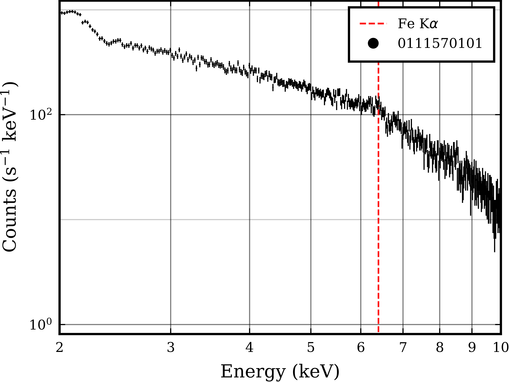

# Data Reduction Summary

:::{.callout-note}
The work in this chapter was completed in Week 3 of the project. It has been detached from the previous chapter as the notes here will prove useful continuously through the remainder of the project, thus quick access is imperative.
:::

Two more bash scripts were made for an intermediate step (`Image-Pipeline.sh`) and the final steps (`Final-Pipeline.sh`) respectively. Both of these scripts can be found on the project GitHub repository. With these, the data reduction only requires the following commands to be run:

## Reprocessing

```{.bash}
# Run the initial pipeline script
bash /data/cluster4/BradleyAndJacob/Scripts/XMM-Pipeline.sh

# Setting Environment Variables
export SAS_ODFPATH="$(pwd)"
export SAS_CCFPATH="/opt/local/XMM/ccf/"
export SAS_CCF="$SAS_ODFPATH/ccf.cif"
export SAS_ODF="$SAS_ODFPATH/$(ls *SUM.SAS)"
export INSTRUMENT="pn"

# Enter the processing directory
cd ../PROC
```

## GTI Filtering

After viewing the lightcurve and determining a filtering expression for a GTI, run

```{.bash}
# Creating the GTI (Good Time Interval) file for time filtering
tabgtigen table="$INSTRUMENT"_ltcrv.fits gtiset=gtiset.fits expression='RATE<=30' 

# Run the image generation pipeline
bash /data/cluster4/BradleyAndJacob/Scripts/Image-Pipeline.sh $INSTRUMENT
```

## Region Selection

Then, open the image in ds9 and select the source and background regions

```{.bash}
# View the image and select regions
ds9 $INSTRUMENT-all.fits &

# Set region expressions as variables, replacing X, Y and R
export SOURCE_CENTRE="X,Y"
export SOURCE_REGION=""$SOURCE_CENTRE",R"
export BACKGROUND_REGION_INNER=""$SOURCE_CENTRE",R"
export BACKGROUND_REGION_OUTER=""$SOURCE_CENTRE",R"
```

## Spectrum Extraction

Then enter one of the following pairs of commands, for the relevant instrument

```{.bash}
# ========== For PN ========== 
# Extract the Source Spectrum
evselect table="$INSTRUMENT"_filt_time.fits energycolumn="PI" filteredset="$INSTRUMENT"_filtered.fits filtertype="expression" expression="((X,Y) in CIRCLE("$SOURCE_REGION"))&&(FLAG==0)&&(PATTERN<=4)" spectrumset=""$INSTRUMENT"_pi.fits" spectralbinsize=5 withspecranges=yes specchannelmin=0 specchannelmax=20479

# Extract the Background Spectrum
evselect table="$INSTRUMENT"_filt_time.fits energycolumn="PI" filteredset="bkg_filtered.fits" filtertype="expression" spectrumset="bkg_pi.fits" spectralbinsize=5 expression="((X,Y) in CIRCLE("$BACKGROUND_REGION_OUTER"))&&!((X,Y) in CIRCLE("$BACKGROUND_REGION_INNER"))&&(FLAG==0)&&(PATTERN<=4)" withspecranges=yes specchannelmin=0 specchannelmax=20479
# ========== For PN ========== 

# ========= For MOS  ========= 
# Extract the Source Spectrum
evselect table="$INSTRUMENT"_filt_time.fits energycolumn="PI" filteredset=""$INSTRUMENT"_filtered.fits" filtertype="expression" expression="((X,Y) in CIRCLE("$SOURCE_REGION"))" spectrumset=""$INSTRUMENT"_pi.fits" spectralbinsize=5 withspecranges=yes specchannelmin=0 specchannelmax=11999

# Extract the Background Spectrum
evselect table="$INSTRUMENT"_filt_time.fits energycolumn="PI" filteredset="bkg_filtered.fits" filtertype="expression" spectrumset="bkg_pi.fits" spectralbinsize=5 expression="((X,Y) in CIRCLE("$BACKGROUND_REGION_OUTER"))&&!((X,Y) in CIRCLE("$BACKGROUND_REGION_INNER"))" withspecranges=yes specchannelmin=0 specchannelmax=11999
# ========= For MOS  ========= 
```

## Pileup Check

Check the spectrum for pileup

```{.bash}
# Check for Pileup
epatplot set="$INSTRUMENT"_filtered.fits plotfile="$INSTRUMENT"_epat.ps useplotfile=yes withbackgroundset=yes backgroundset=bkg_filtered.fits
```

## Response Files and Cleanup

If there is no pileup, run the final script, otherwise reselect the source region to exclude the centre and reduce pileup

```{.bash}
# If no pileup, run the final pipeline
bash /data/cluster4/BradleyAndJacob/Scripts/Final-Pipeline.sh [OBS_ID] $INSTRUMENT 
```

## Test Data

This pipeline was tested on the MCG-6-30-15 dataset with observation ID 0111570101. The GTI was set with the expression "TIME>=79698000", abd the regions were centred at (26880,27661) with radii 1000,2000,4000. The resulting spectrum from the pn instrument (after grouping the bins in groups of 4, cutting the data to 1024 channels) is shown below.



This showed a successful spectrum extraction, and yet another promising dataset. The next steps are to thus begin fitting to data in order to reproduce a plot similar to Figure 1 in Fabian et al. (2002) @fabian_long_2002.