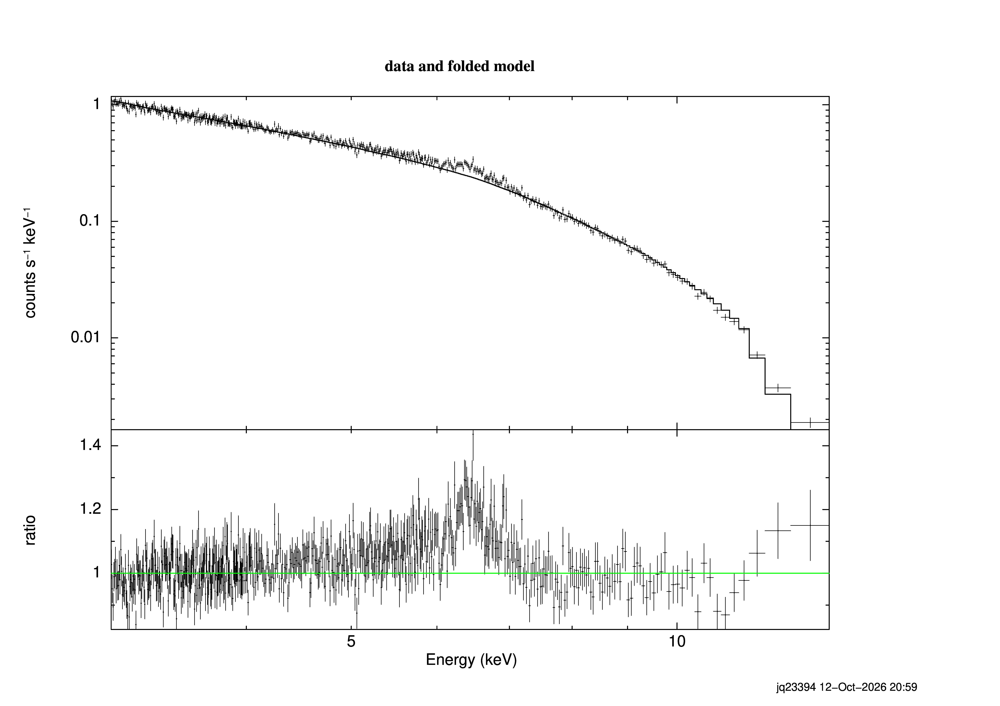
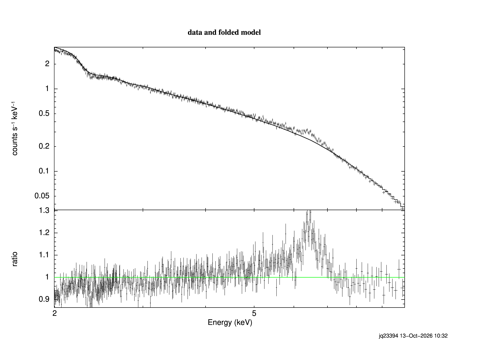
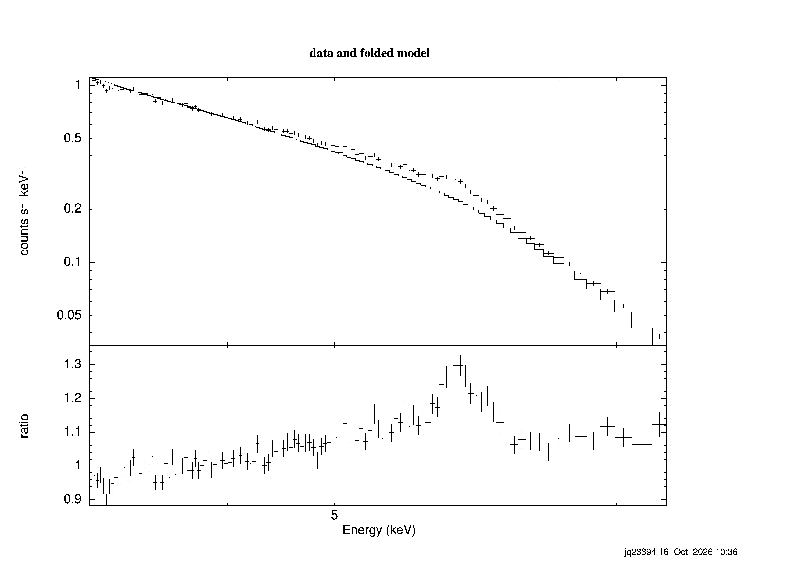
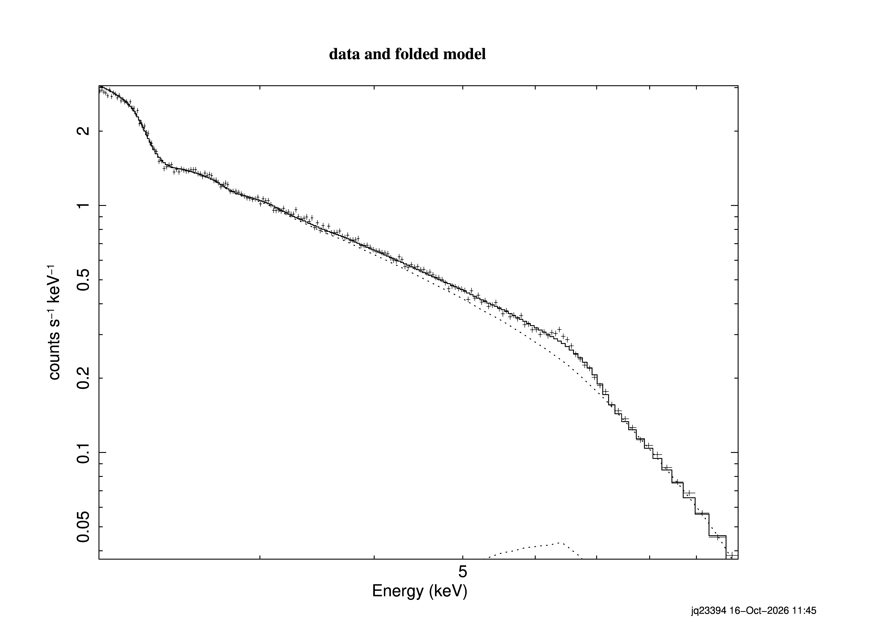
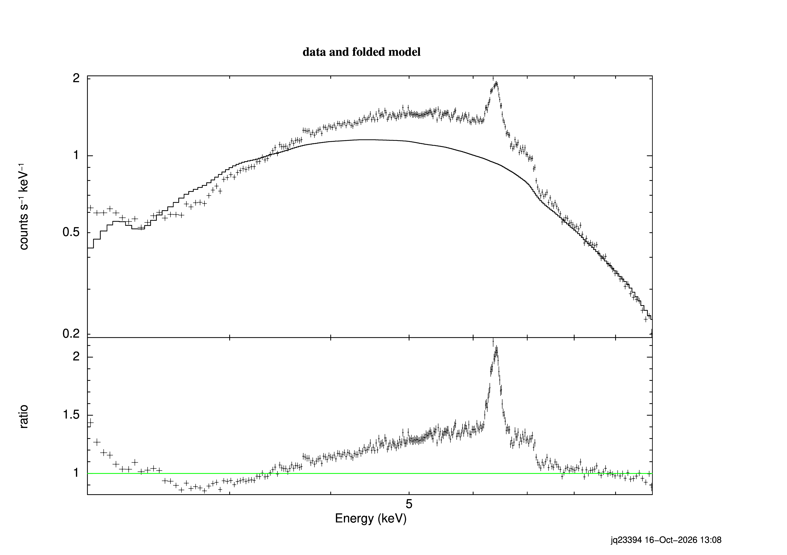
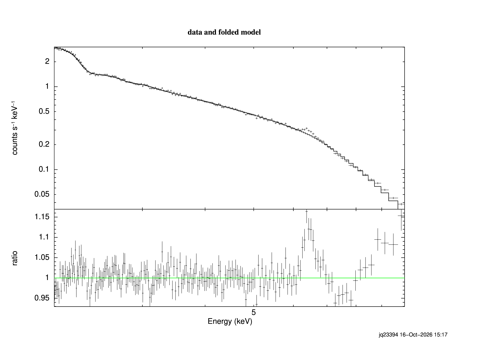
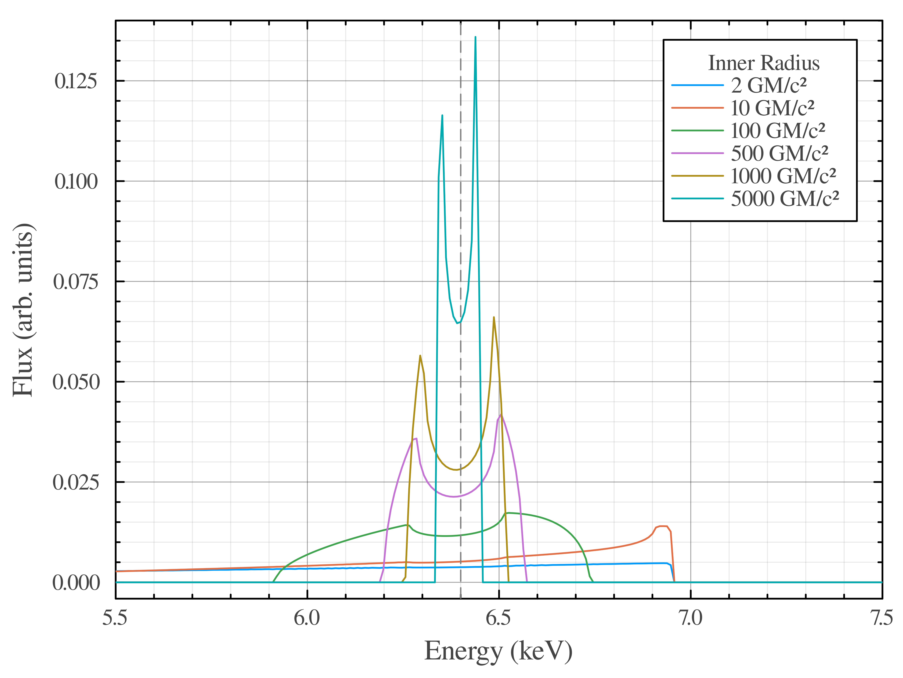

# Week 4

## 2026/10/12

### Initial Fitting Attempt Using XSPEC

In order to inspect the data, it will be useful to fit a power law to the continuum excluding the region where we expect the iron line. Taking the ratio between this fit and the data will thus reveal instructive data on the presence of the Fe-K$\alpha$ line. 

The data was rebinned by grouping the channels into sets of 4 via 

```{.bash}
grppha 0693781301_pn_pi.fits 0693781301_pn_pi_rebinned.fits "group 0 4095 4 & exit"
```

The fitting was then completed in XSPEC, fitting a powerlaw. Once the XSPEC session was started (via the `xspec` command), the following sequence of commands was used.

```{.bash}
# Set plotting parameters and load in the data
cpd 0693781301.ps/CPS
setplot energy
data 0693781301_pn_pi_rebinned.fits

# Setting fitting regions
ignore 0.0-3.0
ignore 15.0-**

# Setting the model to a power law
model powerlaw

# Normalising and ignoring bad channels
renorm
ignore bad

# Plot the data
plot ldata

# Ignore the iron line
ignore 5.0-7.5

# Fit a power law
fit

# Retrieve the iron line data and plot
notice 5.0-7.5
plot ldata ratio

exit
```

The defaults were used as initial guesses for the fitting parameters (the power law index and the normalisation), and the data was curtailed to be within 3 and 15 keV to capture the best power law region. The resulting fit, and the ratio between the fit and data, are shown below.



Further binning may improve this view of the iron line further, which is the next steps.

## 2026/10/13

### Second Attempt at Fitting

The data was rebinned once more, taking bins with a minimum of 600 counts per bin. 

```{.bash}
grppha 0693781301_pn_pi.fits 0693781301_pn_pi_rebinned_min600.fits "chkey BACKFILE 0693781301_pn_bkg_pi.fits & chkey RESPFILE 0693781301_pn_rmf.fits & chkey ANCRFILE 0693781301_pn_arf.fits & group min 600 & exit"
```

This spectrum was fit following the same method as previous, but masking the energy to be between 2-10 keV. The result is shown below



### Converting PostScript Files to PNG

XSPEC and many other packages output plots as `.ps` files, which cannot easily be included in this book. Thus, a bash script was produced to convert these outputs to `.png` without losing resolution.

```{.bash}
#!/bin/bash

# Convert to pdf
ps2pdf $1.ps

# Convert to png
convert -alpha off -density 600 $1.pdf $1.png

# Remove intermediate files
rm $1.pdf
```

This script takes one argument, which is the filename with no extension, i.e. for the plot file `0693781301_min600.ps` one would enter the command

```{.bash}
bash /data/cluster4/BradleyAndJacob/Scripts/ps_to_png.sh 0693781301_min600
```

The script first converts to pdf due to quality losses observed when converting straight to a png.

### Supervisor Meeting Notes

Questions

- Start thinking about presentation
    - General physics audience
    - Can I reuse diagrams from my summer project
        - yes although won't get credit for it as non-examinable
    - Jacob and I are presenting separately
        - How much can we compare notes
            - Can discuss but be careful of accidental plagiarism
        - Can we practice together?
            - Best not to for plagiarism concerns

Notes

- Data is overbinned, Fabian et al. uses 20 cts per bin
    - Can rebin for plotting only using `setplot rebin`
    - Rebin for significance of datapoints
- Presentation
    - Think about what we would want to hear from people in different fields
    - Be aware of your audience
    - Will be individual
        - Can share results and such
- Fabian et al. Figure 3
- Summer project diagrams
    - Cite myself
- Models
    - RELXILL is good
        - Not currently installed
- Use GitHub issues for communication between meetings
- GitHub can be used to render quarto??
    - `.gitlab-ci.yml`
        - Instructions for github to render it

## 2026/10/16

### Rebinning Within XSPEC

Following our supervisor's advice, the power law fit was remade using the original spectrum file (i.e. not rebinned) and rebinning was done within xspec for fitting purposes only. The data was rebinned such that bins with $<40\sigma$ significance were combined, which provided the plot shown below



This plot was produced with the following commands

```{.bash}
# Set plotting parameters and load in the data
cpd 0693781301.ps/CPS
setplot energy
data 0693781301_pn_pi.fits

# Rebinning the data to 40 sigma
setplot rebin 40 100

# Setting fitting regions
ignore 0.0-3.0
ignore 15.0-**

# Setting the model to a power law
model powerlaw

# Normalising and ignoring bad channels
renorm
ignore bad

# Ignore the iron line
ignore 5.0-7.5

# Fit a power law
fit

# Retrieve the iron line data and plot
notice 5.0-7.5
plot ldata ratio

exit
```

### A Naive Line Profile Fit

For demonstration purposes, it was decided to perform a basic fit using the power law as previous, and an iron line component using the model `kerrdisk`. The plot was rebinned using 40$\sigma$ confidence once again.



This is not a good fit, but clearly demonstrates that the data is well described by a continuum and a strong Fe-K$\alpha$ line.

### A Brief Look at Another Object

In order to test the data reduction process, another object (NGC4151) was looked at with observation id 0861680201. The standard process was used with the filtering expression "RATE<12" for the GTI and regions selected centred on (25863.55,23905.16) with radii 1000,2000,4000. The resulting spectrum is shown below.



The iron line in this spectrum is much more prominent, and it does not present with the expected line profile. This could potentially be due to a region of emission that is not effected by the gravity of the black hole, so there are two iron lines present: a relativistic one, and a typical emission line. This spectrum seems much more complex than that of MCG-6-30-16 and is not described well with a simple power law fit. The fit shown is a power law with photoelectric absorption, and describes the fit better than a simple power law, but still fails to fit well.

### RELXILL Installation and Use

[RELXILL](https://www.sternwarte.uni-erlangen.de/~dauser/research/relxill/index.html) is a model for XSPEC that models the reflection spectrum and relativistic blurring from a black hole accretion disk. This was installed to solva by running the following commands

```{.bash}
# Download the model files
wget https://www.sternwarte.uni-erlangen.de/~dauser/research/relxill/relxill_model_v2.9.0.tgz
wget https://www.sternwarte.uni-erlangen.de/~dauser/research/relxill/relxill_tables.tgz

# Extract the files
tar xfz relxill_tables.tgz
tar xfz relxill_model_v2.3.tgz

# Run the compilation script
chmod u+x ./compile_relxill.sh
./compile_relxill.sh
```

:::{.callout-tip title="Loading RELXILL"}
To import the model in an XSPEC session, run 

```{.bash}
lmod relxill /data/cluster4/BradleyAndJacob/relxill
```
:::

With the relxill model installed, an initial attempt at fitting was conducted, following the procedure (with relxill loaded as above):

```{.bash}
# Seet plotting defaults
cpd 0693781301_relxill.ps/CPS
setplot energy
setplot rebin 40 100

# Load Data and relxill
data 0693781301_pn_pi.fits
lmod relxill /data/cluster4/BradleyAndJacob/relxill/

# Setting bounds
ignore 0.0-2.0
ignore 10.0-**

# Defining the model
model relxill

# Cleanup
renorm 
ignore bad

# Fitting
fit

# Plotting
plot ldata ratio
```

The first fit is shown below



More tweaking is necessary to get this fit to converge properly.

## 2026/10/17

### Plots for Presentation

For demonstration purposes when presenting this project to peers, it will be useful to have a demonstration of how the line profile changes with the spin parameter, $a_*$. To demonstrate this, line profiles were simulated with `Gradus.jl`, a relativistic raytracing software implemented in Julia. The code is hosted on the project GitHub under the file `LineProfileSimulation.jl` and produced the following plot


In an attempt to represent the transition from the classical to relativistic regime, line profiles were also simulated for a range of inner disk radii ranging from $2-5000 R_g$ as below.

