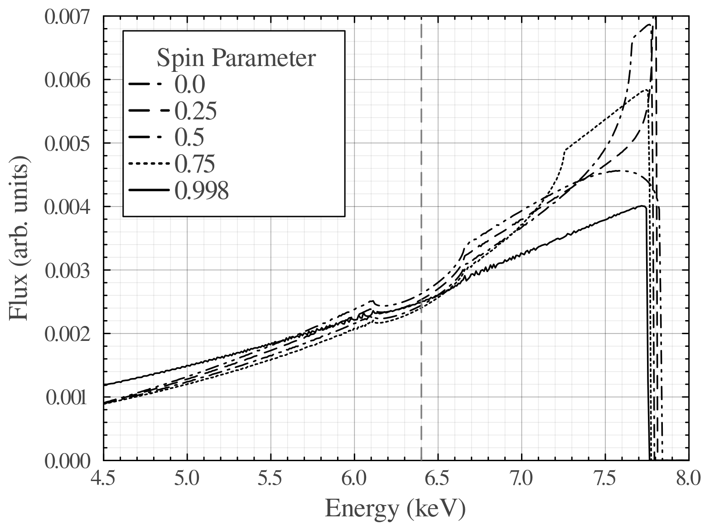
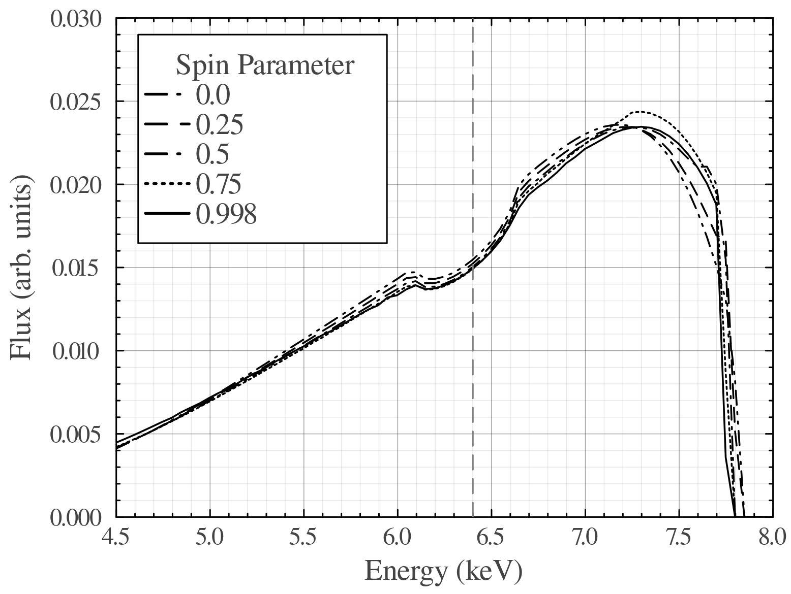
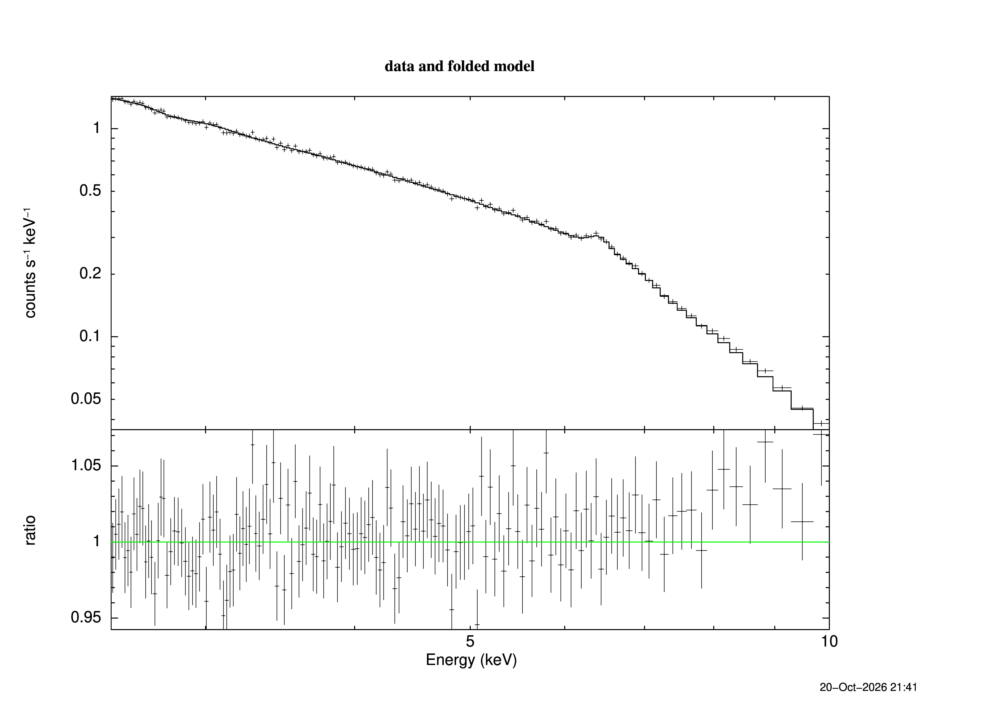
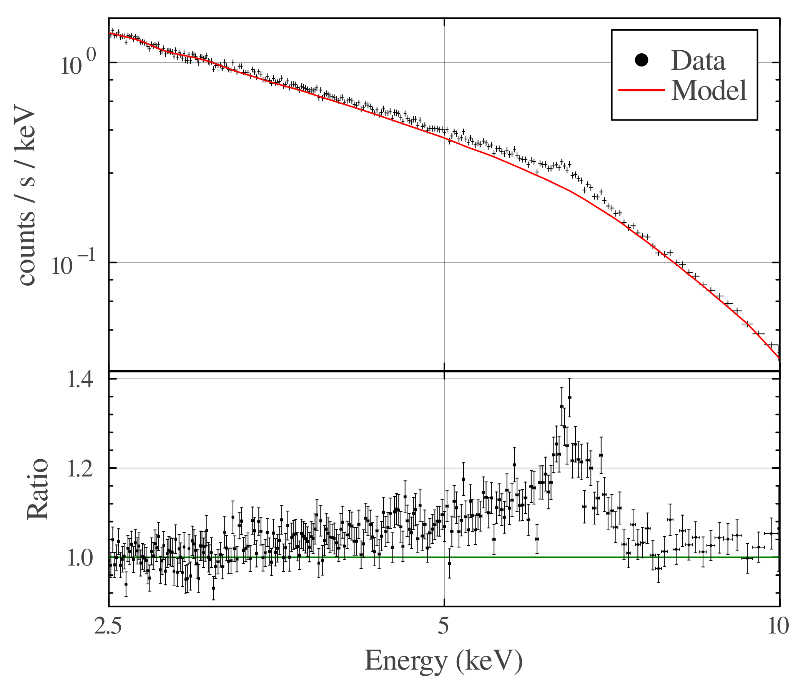

# Week 5

This week was primarily spent preparing to present our work so far, and introduce our project to our peers. 

## 2026/10/20

### Animation for Presentation

For the presentation, an animation was produced using Gradus of the emission line profile as a function of black hole spin $a_*$. The animation can be viewed [here](https://github.com/BradADDay/ProjectIronLine_Labbook/blob/main/images/LineProfileSpin.gif).

The animation was produced using an emissivity profile with index 3, rather than a lamp post model, due to an apparent insensitivity of the lamp post model to the spin parameter. A Github issue has been raised regarding this, and the comparative plots are shown below.

:::{layout-ncol="2"}





:::

The power law emissivity example clearly provides a much stronger dependence of the line profile on the black hole spin.

### Meeting with Supervisor

- Fitting with RELXILL?
    - Andy has responded to Github issues.
- Iron line profile simulations seem to be insensitive to black hole spin for a lamp post corona model
- NGC4151 spectrum
- Audience won't know what an AGN is, clarify that
- More basic intro slide?
    - What an agn is etc.
- RELXILL fitting
    - Add a narrow gaussian for the iron line core
    - Allow the two indices to vary
- NGC4151 spectrum
    - Narrow core
    - is the edge an iron-k edge or the blue wing of the emission line?

### Improved Fitting With RELXILL

```{.bash}
# Setting plotting parameters and reading data
setplot energy
setplot rebin 40 100
data 0693781301_pn_pi.fits

# Ignoring regions
ignore 0.0-2.5
ignore 10.0-**

# Setting the model
model phabs(relxill+gaussian)

# Fitting
fit

# Saving the fit data
iplot
wd ratio_plot
exit

# Plotting
cpd 0693781301_phabs_relxill_gaussian.ps/CPS
pl ld ra
```

The first successful fit is shown below



and the parameters of the fitted model are

```
========================================================================
Model phabs<1>(relxill<2> + gaussian<3>) Source No.: 1   Active/On
Model Model Component  Parameter  Unit     Value
 par  comp
   1    1   phabs      nH         10^22    4.06000E-02  frozen
   2    2   relxill    Index1              5.83847      +/-  1.04543      
   3    2   relxill    Index2              0.614270     +/-  0.826461     
   4    2   relxill    Rbr                 15.0000      frozen
   5    2   relxill    a                   0.986951     +/-  2.37420E-02  
   6    2   relxill    Incl       deg      47.1032      +/-  10.1035      
   7    2   relxill    Rin                 -1.00000     frozen
   8    2   relxill    Rout                400.000      frozen
   9    2   relxill    z                   7.75000E-03  frozen
  10    2   relxill    gamma               1.85337      +/-  8.41063E-02  
  11    2   relxill    logxi               3.14998      +/-  0.118635     
  12    2   relxill    Afe                 1.15236      +/-  0.808068     
  13    2   relxill    Ecut       keV      300.000      frozen
  14    2   relxill    refl_frac           995.055      +/-  6.03775E+05  
  15    2   relxill    norm                1.35694E-03  +/-  6.63929E-06  
  16    3   gaussian   LineE      keV      6.41965      +/-  0.150249     
  17    3   gaussian   Sigma      keV      7.57211E-04  +/-  3.78638E-02  
  18    3   gaussian   norm                8.66050E-06  +/-  1.90348E-06  
________________________________________________________________________
```

## 2026/10/21

The first draft of the presentation was completed and shared with my supervisor for feedback. The power law fit was replotted in Julia and a routine made for parsing the xspec output. 

### Julia Plotting of XSPEC Output

XSPEC outputs data as a `.qdp` file which is similar in structure to a CSV other than a header with the structure:

```
READ SERR 1 2
@ratio_plot.pco
!
```

and different datasets are separated with a line

```
NO NO NO NO NO
```

where there is a "NO" for each column of data. The routine produced therefore runs as follows:

1. The file is read as a string
2. The header is removed by taking the part of the file following the `!`
3. The number of columns is counted by counting the number of spaces on a single line
4. The datasets are split using the separator shown above
5. Each dataset is converted into a dataframe which is stored in an array and returned

The source code is shown below

```{.julia}
function ParseQDP(filename)

    # Open the file
    fileString = open(filename) do file
        read(file, String)
    end

    # Removing the header from the top of the file
    fileString = fileString[findfirst("!", fileString)[end]+2:end]

    # Getting the number of columns
    numcols = count(" ", fileString[1:findfirst("\n", fileString)[1]]) + 1

    # Splitting the datasets
    splitter = join([("NO "^numcols)[1:end-1], "\n"])
    strings = split(fileString, splitter)

    # Generating numbered header
    header = join([join(1:numcols, " "), "\n"])

    # Creating an empty array for each dataset
    output = Array{DataFrame}(undef, length(strings))

    # Assembling dataframes
    for (i, string) in enumerate(strings)
        output[i] = DataFrame(CSV.File(IOBuffer(join([header, String(string)]))))
    end

    return output
end
```

With this parsing function, the data can simply be plotted from the dataframes, which produced the following plot:

