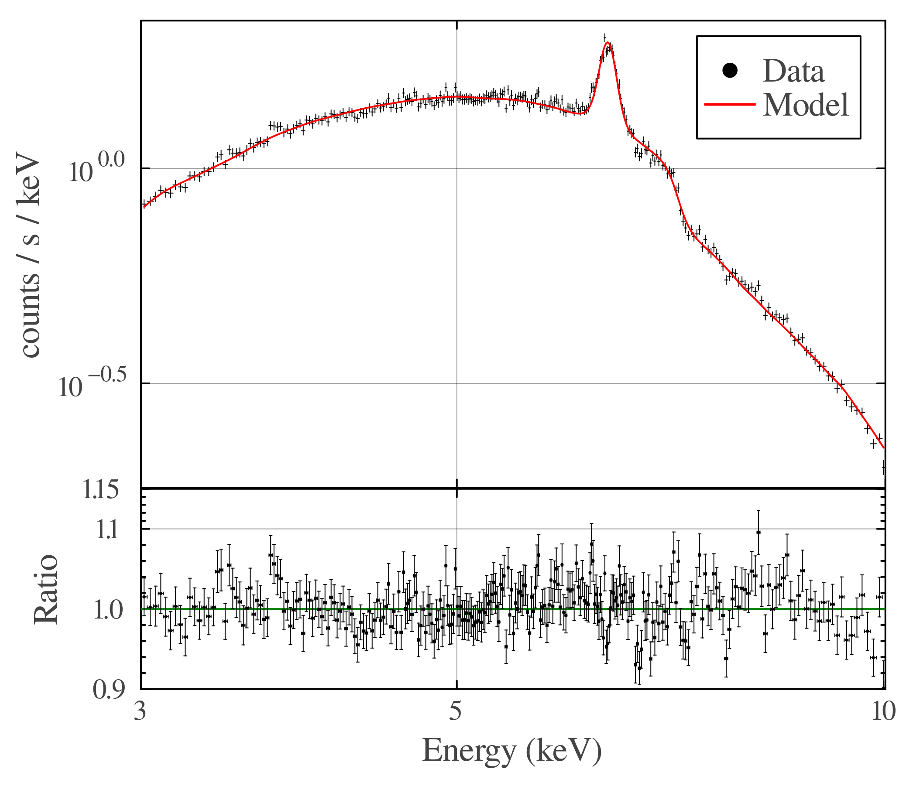

# Week 7

## 2026/11/02

### Fitting More Data With RELXILL

The NGC4151 spectrum from observation 0861680201 was fit with relxill providing the following measurements

```
========================================================================
Model phabs<1>(relxill<2> + gaussian<3>) Source No.: 1   Active/On
Model Model Component  Parameter  Unit     Value
 par  comp
   1    1   phabs      nH         10^22    6.88259      +/-  2.28961      
   2    2   relxill    Index1              10.00000     +/-  3581.91      
   3    2   relxill    Index2              3.68277      +/-  0.111090     
   4    2   relxill    Rbr                 1.60912      +/-  6.14418      
   5    2   relxill    a                   0.983003     +/-  6.95661E-02  
   6    2   relxill    Incl       deg      45.7115      +/-  0.776868     
   7    2   relxill    Rin                 -1.00000     frozen
   8    2   relxill    Rout                400.000      frozen
   9    2   relxill    z                   2.23628E-15  +/-  -1.00000     
  10    2   relxill    gamma               2.45937      +/-  0.182081     
  11    2   relxill    logxi               4.05368E-07  +/-  -1.00000     
  12    2   relxill    Afe                 0.500000     +/-  0.259339     
  13    2   relxill    Ecut       keV      300.000      frozen
  14    2   relxill    refl_frac           1000.00      +/-  2.43321E+04  
  15    2   relxill    norm                2.79388E-03  +/-  9.58041E-04  
  16    3   gaussian   LineE      keV      6.37912      frozen
  17    3   gaussian   Sigma      keV      4.25369E-04  +/-  -1.00000     
  18    3   gaussian   norm                2.36581E-04  +/-  1.11475E-05  
________________________________________________________________________
```



This provided a good fit, however some of the parameters are near nonsensical, for example the reflection fraction (fraction of the spectrum which is the reflection vs the continuum) is extremely high. This may be able to be balanced out by increasing the iron abundance.

In order to refine our fits it is useful to understand the models further, the parameters for the current model are:

:::{.callout-tip}
| Model      | Parameter   | Description                                              | Units               |
|------------|-------------|----------------------------------------------------------|---------------------|
| `relxill`  | `Index1   ` | Inner emissivity index (between Rin and Rbr)             |                     | 
|            | `Index2   ` | Outer emissivity index (between Rbr and Rout)            |                     |
|            | `Rbr      ` | Break radius of emissivity profile, between Rin and Rout | $R_G$               |      
|            | `a        ` | Black hole spin                                          |                     | 
|            | `Incl     ` | Inclination of the accretion disk                        | degrees             |        
|            | `Rin      ` | Inner radius of accretion disk                           | $R_G$               |      
|            | `Rout     ` | Outer radius of accretion disk                           | $R_G$               |      
|            | `z        ` | Redshift                                                 |                     | 
|            | `gamma    ` | Power law index of incident spectrum                     |                     |  
|            | `logxi    ` | Ionisation of accretion disk                             |                     | 
|            | `Afe      ` | Iron abundance of accretion disk                         | Solar units         |      
|            | `Ecut     ` | High energy cutoff                                       | keV                 |    
|            | `refl_frac` | Reflection fraction                                      |                     |
|            | `norm     ` | Normalisation                                            |                     |
| `gaussian` | `LineE    ` | Line energy                                              | keV                 |    
|            | `Sigma    ` | Standard deviation                                       |                     |
|            | `norm     ` | Normalisation                                            |                     |
| `phabs`    | `nH       ` | Equivalent hydrogen column                               | $10^{22}$ cm$^{-2}$ |
:::

## 2026/11/03

### Lamppost Model Fitting

Relxill also has a model for a lamppost corona which can be fit to our data. This model was fit to both the 

:::{.callout-note title="The fitted model for the MCG-6-30-15 dataset"}
```
========================================================================
Model phabs<1>(relxilllp<2> + gaussian<3> + powerlaw<4>) Source No.: 1   Active/On
Model Model Component  Parameter  Unit     Value
 par  comp
   1    1   phabs      nH         10^22    1.01078      +/-  0.943206     
   2    2   relxilllp  h          GM/c^2   3.58987      +/-  6.31320      
   3    2   relxilllp  beta       c        0.0          frozen
   4    2   relxilllp  a                   0.998000     +/-  0.657700     
   5    2   relxilllp  Incl       deg      41.1673      +/-  5.57398      
   6    2   relxilllp  Rin                 -1.00000     frozen
   7    2   relxilllp  Rout                400.000      frozen
   8    2   relxilllp  z                   7.75000E-03  frozen
   9    2   relxilllp  gamma               2.11581      +/-  0.540788     
  10    2   relxilllp  logxi               3.43265      +/-  0.820139     
  11    2   relxilllp  Afe                 0.500000     +/-  1.56704      
  12    2   relxilllp  Ecut       keV      300.000      frozen
  13    2   relxilllp  refl_frac           995.933      +/-  8.71667E+05  
  14    2   relxilllp  switch_returnrad         1            frozen
  15    2   relxilllp  switch_reflfrac_boost         0            frozen
  16    2   relxilllp  norm                1.45849E-03  +/-  1.69083E-03  
  17    3   gaussian   LineE      keV      6.42440      +/-  2.04951E-02  
  18    3   gaussian   Sigma      keV      9.26875E-02  +/-  3.01751E-02  
  19    3   gaussian   norm                1.65882E-05  +/-  3.32912E-06  
  20    4   powerlaw   PhoIndex            1.12558      +/-  5.03741      
  21    4   powerlaw   norm                4.01063E-04  +/-  7.43608E-03  
________________________________________________________________________
```
:::
:::{.callout-note title="The fitted model for the NGC4151 dataset"}
```
========================================================================
Model phabs<1>(relxilllp<2> + gaussian<3> + powerlaw<4>) Source No.: 1   Active/On
Model Model Component  Parameter  Unit     Value
 par  comp
   1    1   phabs      nH         10^22    8.82945      +/-  1.05723      
   2    2   relxilllp  h          GM/c^2   42.7476      +/-  7.00239      
   3    2   relxilllp  beta       c        0.0          frozen
   4    2   relxilllp  a                   0.915320     +/-  0.220502     
   5    2   relxilllp  Incl       deg      86.3677      +/-  1.35177      
   6    2   relxilllp  Rin                 -1.00000     frozen
   7    2   relxilllp  Rout                400.000      frozen
   8    2   relxilllp  z                   3.26200E-03  frozen
   9    2   relxilllp  gamma               2.88971      +/-  0.209922     
  10    2   relxilllp  logxi               1.55449      +/-  0.300409     
  11    2   relxilllp  Afe                 0.500000     +/-  0.689135     
  12    2   relxilllp  Ecut       keV      300.000      frozen
  13    2   relxilllp  refl_frac           999.353      +/-  6558.41      
  14    2   relxilllp  switch_returnrad         1            frozen
  15    2   relxilllp  switch_reflfrac_boost         0            frozen
  16    2   relxilllp  norm                2.76968E-03  +/-  1.54535E-03  
  17    3   gaussian   LineE      keV      6.37503      +/-  1.80849E-02  
  18    3   gaussian   Sigma      keV      1.60642E-05  +/-  2.14195E-04  
  19    3   gaussian   norm                2.27356E-04  +/-  8.35504E-06  
  20    4   powerlaw   PhoIndex            0.573749     +/-  0.598464     
  21    4   powerlaw   norm                1.90353E-03  +/-  3.49226E-03  
________________________________________________________________________
```
:::

### Supervisor Meeting

- Next steps:
    - Focus on MCG-6 and look at other datasets
    - Can combine data and look at different epochs
    - Maybe looking at XRISM data?
    - Can run MCMC in XSPEC
    - nDspec in python
- MCMC 
    - Uses a number of walkers to vary the parameters looking for the best fit
    - Initial burn in period where the fit statistic is improving
    - Towards the end have a good fit, oscillating around the best fit
    - Can use to estimate errors by seeing the gaussian distribution around the best fit
    - use `nDspec`?
    - use Julia `SpectralFitting`?
- Look at recent XRISM results for MCG-6
    - This might help reduce the reflection fraction
- Amount of reflection increases with decreasing flux
    - See paper shared by Andy

### Refining the Fitting Process

Following the meeting with our supervisor, it was decide that the next steps should be to refine our fitting processes. The best method for fitting our data will be MCMC fitting, where a random walk is used to fit the data and estimate the error through observing the gaussian distribution around the best fit.

In order to do this, it was decided to focus on fitting MCG-6-30-15 data, as such every dataset from the XMM archive for this object was downloaded.

The data was downloaded from the observations tabulated below. With these downloaded, it will be possible to fit all of them and compare the results. This will first require processing/reducing the data. The processing inputs for the *pn* instrument are tabulated below. This table will be completed as I work through the datasets.

::: {.list-table}

- - OBSID
  - Exposure (s)
  - GTI Filter
  - SRC Cen (px)
  - SRC Rad (px)
  - BGD Rad (px)
  - Pileup (Y/N)
  - Notes
- - 0111570101
  - 46453
  - TIME>=7698000
  - 26880, 27661
  - 1000
  - 2000, 4000
  - N
- - 0111570201
  - 66197
  - RATE<=23
  - 
  - 
  - 
  - 
- - 0111570401
  - 17467
  - RATE>=0
  - 
  - 
  - 
  - 
- - 0693781201
  - 134214
  - 
  - 
  - 
  - 
  - 
- - 0693781301*
  - 134214
  - RATE<=30
  - 25628, 23912
  - 1000
  - 2000, 4000
  - N
- - 0693781401
  - 48918
  - 
  - 
  - 
  - 
  - 
- - 0921420101
  - 135700
  - 
  - 
  - 
  - 
  - 
- - 0029740101
  - 89432
  - RATE>=0
  - 26216.35, 27946.838
  - 1500
  - 2000, 4000
  - N
- - 0029740701
  - 129367
  - RATE<=35
  - 26239.559, 27974.981
  - 1500
  - 2000, 4000
  - N
- - 0029740801
  - 130497
  - RATE<=40
  - 26229.416, 28001.849
  - 1500
  - 2000, 4000
  - N
- - 0029740901
  - 1169
  - 
  - 
  - 
  - 
  - 
  - No pn data
- - 0029741001
  - 1168
  - 
  - 
  - 
  - 
  - 
  - No pn data
:::
\* Previously used data

## 2026/11/08

### Further Automating Data Reduction

Given the large amount of data that needs reducing, it was decided to determine if it would be possible to further automate the data reduction. The three steps that need automation are: 

1. Determining the good time interval
2. Selecting the source and background regions
3. Checking for pileup (and reducing the effects if pileup is present)

It was decided to first tackle the source detection, which can be split into two steps:

1. The centroid detection
2. Determining the size of the regions

To determine the centre, a python script was written making use of the `astropy` and `photutils` libraries. As the objects we are looking at are point sources, we can conveniently use a star finding algorithm. `astropy` was used to read in and manipulate the image, and the `DAOStarFinder` utility was used to detect the source. This works as our data currently consists of only a single source, however our procedure may need to be reconsidered if we use datasets where that is not the case. The current version of the code is currently as follows

```{.python}
import numpy as np

import matplotlib.pyplot as plt
from matplotlib.colors import LogNorm

from astropy.io import fits
from astropy.stats import sigma_clipped_stats
from photutils.detection import DAOStarFinder

def FindSource(hdu):
    """
    Find the centre of the brightest source in an image
    """

    # Taking the data and conversion factor between image and detector coords
    data = hdu.data
    factor = hdu.header["CDELT1L"]

    # Detecting sources
    mean, median, std = sigma_clipped_stats(data, sigma=3.0)
    daofind = DAOStarFinder(fwhm=3.0, threshold=1*std)
    sources = daofind(data - median)

    # Taking the brightest source detected
    source = sources[sources["mag"] == sources["mag"].min()]

    source = np.array([source["x_centroid"].data[0], source["y_centroid"].data[0]])

    return source, factor
```

This simply returns the centre coordinates (in image coordinates) and `factor` is the conversion factor between image and detector coordinates. The second step of the source region selection was produced by my partner, and these can be combined into the routine. 

The pileup check is similarly trivial to automate, as we can simply assume no pileup for now and manually reprocess cases where pileup is a factor. This is currently assumed to be a valid approach as pileup does not seem to be an issue for our data, however if it becomes more prevalent in future investigations, this may need to be re-evaluated.

Automating the good time interval selection will be the next step, this may be possible through simply defining a threshold (for example within a given number of $\sigma$).

As each automated step will be susceptible to errors due to assumptions made, each of these steps will be written such that they produce an output which can be inspected by a human. For the source detection, this will be a plot of the regions selected, and for the GTI selection this will be a plot showing the threshold.