# Week 8

## 2026/11/09

### Continuing to Automate Data Reduction - GTI Filtering

The next step to automate is the GTI filtering, which can be done by looking at the distribution of the light curves. By simply finding the mean count rate, we can filter for the data to be within a given number of standard deviations as follows

```{.python}
from astropy.io import fits
import numpy as np
import matplotlib.pyplot as plt

def FindBounds(data, sigma=1):

    mean = np.mean(data)
    std = np.std(data)

    expression = f"(RATE<={mean+std})&&(RATE>={mean-std})"

    return expression, mean, std
```

This code can then return a string containing the filtering expression to be passed to the `evselect` command. The result of this is demonstrated in the figure below

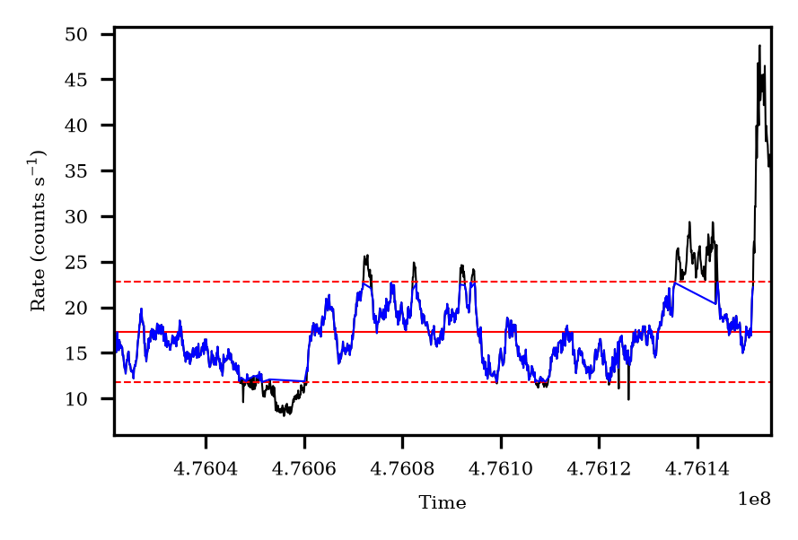

The solid red line shows the mean flux of the observation, and the dashed lines show the $\pm 1\sigma$ boundaries. Finally the blue curve shows the data selected from this GTI filter.

### Source Selection

While my partner continues to work on the determining of the region sizes, it was decided to test the source selection with manually set region radii of 2500,3000, and 5000 pixels such that the automation could be tested. The result of the first test of this is shown below

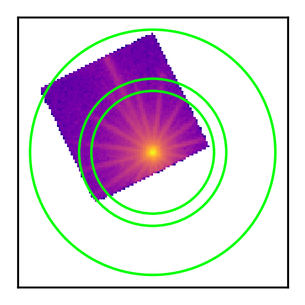

This test showed good results, and the source is successfully centred in the regions as intended. 

## 2026/11/10

### Automation Continued

The final step of the automation is to combine the scripts into one file, for which the previously produced bash scripts were adapted. The scripts can be accessed through the shared repository [here](https://github.com/phajy/project-iron-lines/tree/main/xmm_data_reduction) and are structured as

```
XMM_Pipeline.sh
    ├── Pipelines.sh
    |   └── GTIFilter.py
    └── Extraction.sh
        └── FindSource.py
```

where the `XMM_Pipeline.sh` file calls `GTIFilter.py` and so on. Each file has the following function:

1. `XMM_Pipeline.sh`
    - The main script
    - Calls all of the others
    - Run from the `ODF` directory
2. `Pipelines.sh`
    - Runs all of the XMM-SAS pipelines
    - Calls `GTIFilter.py`
3. `GTIFilter.py`
    - Determines the GTI filtering expression (output as a `.txt` file)
4. `Extraction.sh` 
    - Handles the generation of images, spectra, and response files
    - Calls `FindSource.py`
5. `FindSource.py`
    - Determines the source/background regions

This structure was chosen as it allows for consecutive processing of each instrument without re-running unnecessary code. The script is called as

```{.bash}
cd /PATH/TO/ODF/DIR/
bash /PATH/TO/SCRIPT/DIR/XMM_Pipeline.sh [OBS_ID] [INSTRUMENT]
```

Where `[OBS_ID]` and `[INSTRUMENT]` are replaced with the observation ID of the data and the instrument to be processed, respectively. To process another instrument after running the full pipeline, run

```{.bash}
cd /PATH/TO/PROC/DIR/
bash /PATH/TO/SCRIPT/DIR/Extraction.sh [OBS_ID] [INSTRUMENT]
```

where `/PATH/TO/PROC/DIR/` is the processing directory produced by the main pipeline. It will be located in the same directory as the ODF directory.

### Supervisor Meeting

Topics

- Automation of data reduction
    - Check our process is valid
    - Any other ideas?
- nDspec
    - How to add relxill?

Minutes

- Error bars in data are poisson noise
- For GTI filtering increase tolerances to only clip the big flares
- Source selection
    - May need to select corner of chip rather than ring around it
    - May have issues with selecting data off of chip
    - Maybe select background regions as small circles in valid regions
        - Determine chip region
        - Find source region
        - Select background regions as far from source as possible
    - Andy has recommended some papers which may be instructive

## 2026/11/11

### Automating Region Selection

The previous method of background region selection suffered from two main issues:

1. It a lot of the time included parts of the psf of the source
2. It included unused regions of the chip, which can skew the measurements

With this in mind, it was decided to pursue a different approach, taking the regions in the furthest corner of the chip. A geometrical approach was found as follows

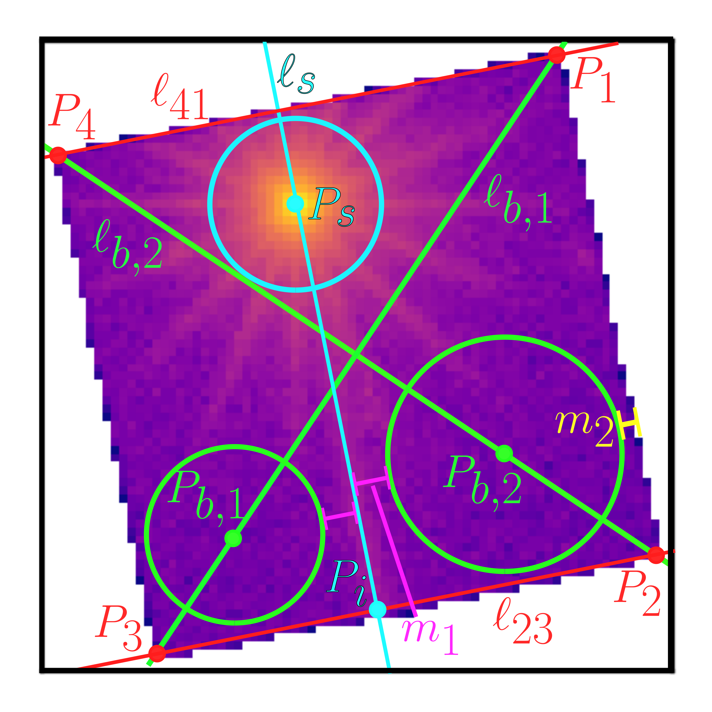

To select these regions, the following algorithm is proposed

:::{.callout-tip title="The new algorithm for region selection in EPIC-pn small window data"}
1. Find the centre of the source using the previous DAOStarFinder implementation ($P_s$)
2. Find the corners of the window within the image ($P_1,P_2,P_3,P_4$)
    - This can be done by finding the first/last rows/columns of the image that contain data
3. Take the two corners furthest from the source and draw a line between them ($\ell_{23}$)
    - This is done by finding the gradient and intercept of the line between the points:
$$m_{23} = \frac{P_{2,y}-P_{3,y}}{P_{2,x}-P_{3,x}}, \qquad c_{23} = P_{2,y} - mP_{2,x}$$
    - Where the subscript 23 connects the value to the corresponding line ($\ell_{23}$)
4. Draw a line from the source ($\ell_s$) which perpendicularly bisects the line found in the previous step and find the intercept between the two ($P_i$)
    - This uses the gradient calculated in the previous step and calculates the y-axis intercept as
$$c_s = P_{s,y} + \frac{P_{s,x}}{m_{23}}$$
    - These two lines then intersect at
$$P_i = \left(-\frac{c_{23}-c_s}{m_{23} + 1/m_{23}},\quad -m_{23}\frac{c_{23}-c_s}{m_{23} + 1/m_{23}}+c_{23}\right)$$
5. The radii of the background regions can be taken from the distances between this intercept and each respective corner ($|\vec{P}_2-\vec{P}_i|$ and $|\vec{P}_1-\vec{P}_i|$)
    - This will include some margin $m_1$ to account for PSF of the source
$$r_{b,j} = \frac{1}{2}\left(\left|\vec{P}_j-\vec{P}_i\right| - m_1 - m_2\right)$$
    - where $m_2$ is a margin from the frame of the window 
6. The lines connecting opposing corners ($\ell_{b,1}$ and $\ell_{b,2}$) can then be found, and the centres of the background regions can be found by moving a distance along this line from the respective corners equal to
$$\frac{1}{2}\sqrt{2(d_{b,j} + m_2)^2}$$
    - where $d_{b,j} = 2r_{b,j}$
    - The $+ m_2$ here ensures that the region is a distance $m_2$ from the border of the window
7. Finally, the radius of the source region can be determined as the perpendicular distance from the source to the line connecting the two closest corners ($\ell_{41}$) minus the margin $m_2$
:::

This algorithm was implemented in python and produced the following image upon testing:

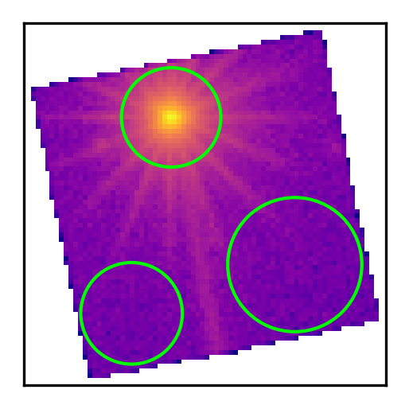

Following this success, the algorithm was implemented into the full pipeline and tested on every dataset for MCG-6-30-15. All of the tests which produced an output are shown below

:::{layout-ncol="2"}
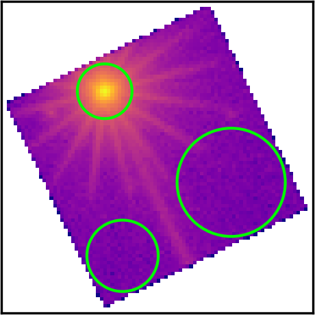

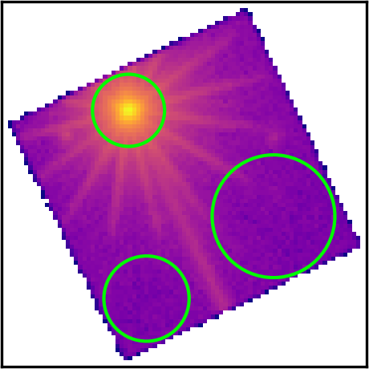

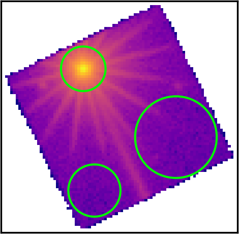

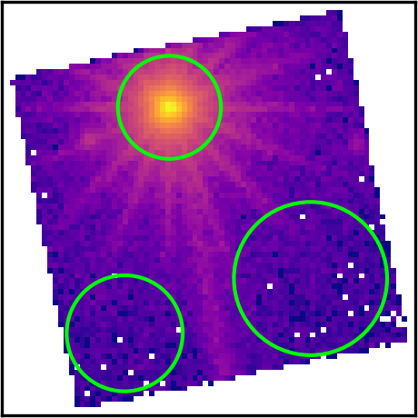

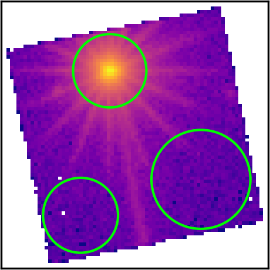

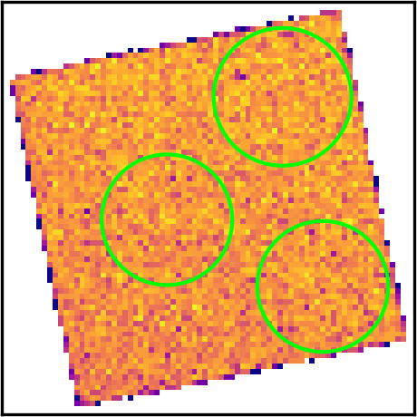

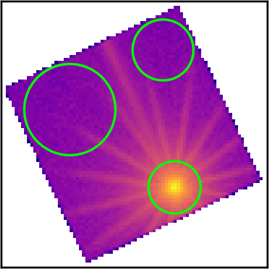

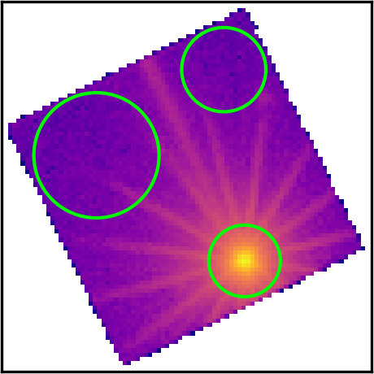

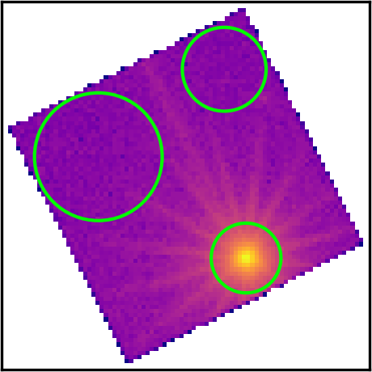

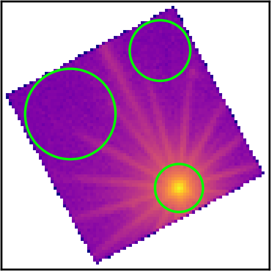
:::

It is clear that the algorithm is successful for all data where the image makes sense. Observation IDs 0029740901 and 0029741001 had no data for the pn instrument and are thus disregarded. Observation ID 0111570401 seemingly has either extremely noisy, or no data. The reason for this becomes clear from looking at the light curve where the count rate was seen to be low and the exposure time was short.

Diagnostic plots such as these will be invaluable for the automation process, and will allow us to catch any errors in the pipeline before using the data. The current pipeline script produces diagnostic plots for the GTI filtering, region selection, and photon pileup.

### pn Pipeline Script Usage

With the script now in working order for the pn data, it is useful to summarise its usage. The script is split into the same 5 files listed previously, two of which are set up to be called by the user. 

:::{.callout-important title="Pipeline Environment"}
The pipeline scripts assume access to HEASOFT packages, the XMM-SAS software and a python distribution containing the necessary dependencies. The python dependencies can be installed as

```{.bash}
pip install astropy numpy matplotlib photutils
```
:::

The main pipeline script `XMM_Pipeline.sh` has the following usage

```
Usage: /PATH/TO/SCRIPT/XMM_Pipeline.sh [-o OBS_ID] [-i INSTRUMENT] [-s SIGMA]

    Options:
        -o, --obs-id:       Observation ID
        -i, --instrument:   Instrument
        -s:                 GTI standard deviation
        --source-max:       Maximum radius of source region
        --m1, --margin1:    Margin from primary flare of PSF
        --m2, --margin2:    Margin from edge of window
```

This pipeline runs all of the preprocessing, GTI filtering, image generation, spectrum extraction, and response file generation commands, and calls the two sub scripts `Pipelines.sh` and `Extraction.sh`. The former is not currently designed to be called directly, and the latter has the following usage

```
Usage: /PATH/TO/SCRIPT/Extraction.sh [-o OBS_ID] [-i INSTRUMENT] [--source-max SOURCE_MAX] [--m1 MARGIN1] [--m2 MARGIN2]

    Options:
        -o, --obs-id:       Observation ID
        -i, --instrument:   Instrument
        --source-max:       Maximum radius of source region
        --m1, --margin1:    Margin from primary flare of PSF
        --m2, --margin2:    Margin from edge of window
```

This can be called after an initial processing run to re-select regions, or to run the script for a different instrument (although this is not currently implemented).