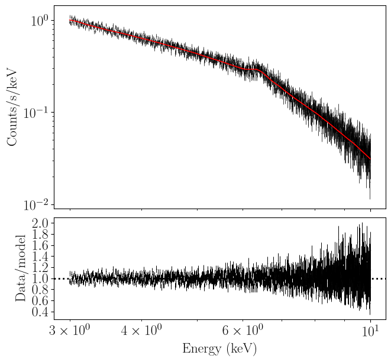
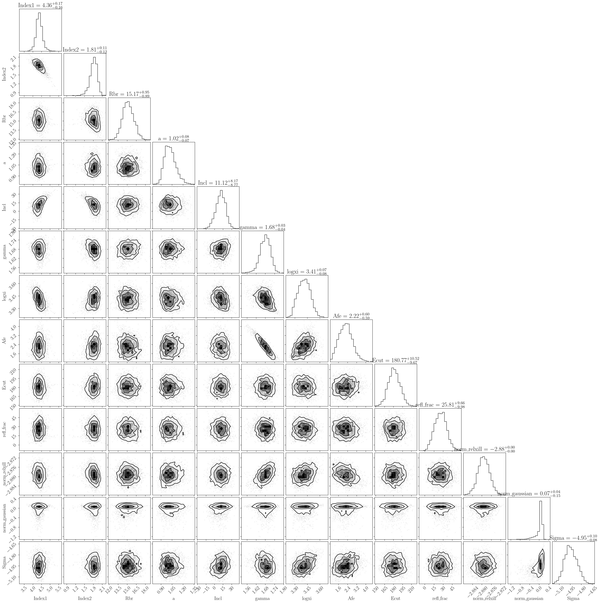

# Week 9 

## 2026/11/17

While Jacob works on the mos reduction pipeline, I intend to spend the week learning the python spectral fitting program `nDspec`. The documentation can be found [here](https://ndspec.readthedocs.io/en/latest/index.html)

I worked through the getting started instructions for fitting time averaged spectra and fit a power law to the data. The code is shown below

```{.python}
import os
import warnings

#this is necessary to disable numpy's default parallelization, which
#interferes with sampling performance.
os.environ["OMP_NUM_THREADS"] = "1"
os.environ["OPENBLAS_NUM_THREADS"] = "1"
os.environ["MKL_NUM_THREADS"] = "1"
os.environ["VECLIB_MAXIMUM_THREADS"] = "1"
os.environ["NUMEXPR_NUM_THREADS"] = "1"

#this is to parallelize our samplers to speed them up
from multiprocessing import Pool

import sys
import numpy as np
import gc
import emcee

#this is to remove weird font warnings
import logging
logging.disable(logging.WARNING)

sys.path.append(os.path.dirname(os.path.dirname(os.path.abspath('__file__'))))
from ndspec.Response import ResponseMatrix
import ndspec.FitTimeAvgSpectrum as fitspec
import ndspec.XspecInterface as XSModels
from ndspec.Plotting import set_plot_style

from lmfit import Model as LM_Model

# Observation ID and instrument for data to be looked at
obsid = "0693781301"
instrument = "pn"

# Path to the data
path = "/home/jq23394/Data/MCG-6-30-15/0693781301/PRODUCTS/"

# Loading the response matrices
rmfpath = f"{path}{obsid}_{instrument}_rmf.fits"
nicer_matrix = ResponseMatrix(rmfpath)
arfpath = f"{path}{obsid}_{instrument}_arf.fits"
nicer_matrix.load_arf(arfpath)

# Loading the spectrum
spectrum_fit = fitspec.FitTimeAvgSpectrum()
spectrum_fit.set_data(nicer_matrix, f"{path}{obsid}_{instrument}_pi.fits")
spectrum_fit.ignore_energies(0,2.5)
spectrum_fit.ignore_energies(10.0,100.0)
spectrum_fit.ignore_energies(4.0,8.0)

model_library = XSModels.ModelInterface()
model_library.add_models("powerlaw")
model_library.print_model_info()

def ndspec_powerlaw(ear,PhoIndex,powerlaw_norm):
    par_array = np.array([PhoIndex,powerlaw_norm])
    model = model_library.powerlaw(ear,par_array)
    return model

unfolded_model = LM_Model(ndspec_powerlaw)
start_params = unfolded_model.make_params(
    PhoIndex=dict(value=-1.0, min=-3.0, max=10.0),
    powerlaw_norm=dict(value=1.0, min=0.0, max=1E+6)
)

spectrum_fit.set_model(unfolded_model,params=start_params)
spectrum_fit.fit_data()
set_plot_style()
spectrum_fit.notice_energies(4.0,8.0)
fig, ax = spectrum_fit.plot_model(
    units="data", plot_components=True, return_plot=True, residuals="ratio",
    data_kwargs={"color":"black", "markersize":0.1, "linewidth":0.7},
    model_kwargs={"color":"red", "linewidth":1},
    resid_kwargs={"color":"black", "markersize":0.1, "linewidth":0.7},
    component_kwargs={"ndspec_powerlaw": {"color":"red","label":"powerlaw"}
    }
)

spectrum_fit.ignore_energies(4.0,8.0)

import ndspec.SamplingUtils as sampling

#first, we define the data and models that will be used by the sampler
sampling.set_sampling_data(spectrum_fit)
sampling.set_sampling_model(spectrum_fit)

#we will initialize our mcmc sampler from the best-fitting parameters we just found
theta = sampling.set_sampling_parameters(spectrum_fit.model_params)

ndim = len(theta)

print(theta)

PhoIndex_prior = sampling.priorUniform(1.0, 2.5)
norm_prior = sampling.priorUniform(0, 0.5)

my_priors = {
    "PhoIndex": PhoIndex_prior,
    "powerlaw_norm": norm_prior
}

sampling.set_sampling_priors(spectrum_fit, my_priors)


#finally, we can sanity check our initial guess by calculating the likelihood. In the case of emcee and other MCMC algorithms,
#the function that gets called needs to include the product of likelihood*priors.
likelihood = sampling.mcmc_gaussian_likelihood(theta)
print("mcmc likelihood",likelihood)
sampling.mcmc_gaussian_likelihood

import emcee

nwalkers = int(10*ndim)
steps = int(1000)

#pos is the initial positions of the walkers - we will set it to be within 1% of the optimizer values
pos = theta*(1+ 1e-2 * np.random.randn(nwalkers, len(theta)))
print(pos)

#we'll run the sampler over 8 cores
basic_sampler = emcee.EnsembleSampler(nwalkers, ndim, sampling.mcmc_gaussian_likelihood)
basic_sampler.run_mcmc(pos, steps, progress=True);

tau_basic = basic_sampler.get_autocorr_time(tol=1)
print(tau_basic)

import corner
import gc

thin_basic = np.mean(tau_basic)

basic_samples = basic_sampler.get_chain(discard=int(2*thin_basic), thin=int(0.5*thin_basic), flat=True)

labels=["PhoIndex","powerlaw_norm"]

#note that the first sampler has a longer autocorrelation lenght, meaning it contains fewer samples,
#meaning the normalization of the distribution is lower even if the intervals and shape are identical.
fig = corner.corner(basic_samples, labels=labels)

gc.collect()
```

### Meeting with Supervisor

- Drop at ~2 keV is due to absorption by the gold (gold edge)
- The one at around 0.7 is another edge
- Can load relxill into nDspec using information [here](https://ndspec.readthedocs.io/en/latest/xspec_interface.html#User-defined-models)

## 2026/11/18

### Moving my Workflow to the Remote Server

In order to use relxill with nDspec, it needs access to the relxill files. Rather than downloading all of the software locally, it was decided to work on the remote server, for which I set up a jupyter server. 

:::{.callout-tip title="How to connect to the jupyter server"}
```{.bash}
# Run on the remote server within the python environment
jupyter notebook --no-browser --port=8080

# Set up a remote tunnel to the server
# Run in vscode locally
ssh -L 8080:localhost:8080 jq23394@solva.phy.bris.ac.uk
```

In the local jupyter notebook file select the kernel and paste the url which will look something like 

```
http://localhost:8080/tree?token=aed20a7aace97b3497bbc7f62aa37bfcdcdb664987f755a8
```
:::

:::{.callout-important title="Python Environment Setup"}
For the Jupyter server to work correctly, the python environment needs `ipykernel` to be installed as

```{.bash}
pip install ipykernel
```

and the kernel must be setup as 
```
python3 -m ipykernel install --user --name=projectname
```

where `projectname` is the name of the python environment.
:::

### Adding RELXILL to nDspec

Following the instructions in the documentation, relxill can be loaded as

```{.python}
relxillpath = os.path.expanduser("/data/cluster4/BradleyAndJacob/relxill/librelxill.so")
relxillfile = os.path.expanduser("/data/cluster4/BradleyAndJacob/relxill/lmodel_relxill.dat")

model_library.add_library(relxillpath, relxillfile)
model_library.add_models("relxill")
model_library.print_model_info()
```

### MCMC with RELXILL in nDspec

Markov-Chain Monte Carlo fitting is implemented in nDspec through the emcee library. To use this with RELXILL the model was first fit as normal as given in the documentation, an example code block is shown below.

```{.python}
# Loading models
model_library.add_models("powerlaw", "relxill", "gaussian", "phabs")

# Defining model wrappers

def ndspec_powerlaw(ear,PhoIndex,norm_powerlaw):
    par_array = np.array([PhoIndex,norm_powerlaw])
    model = model_library.powerlaw(ear,par_array)
    return model

def ndspec_relxill(ear,Index1,Index2,Rbr,a,Incl,Rin,Rout,z,gamma,logxi,Afe,Ecut,refl_frac,norm_relxill):
    norm_relxill = 10**norm_relxill
    par_array = np.array([Index1,Index2,Rbr,a,Incl,Rin,Rout,z,gamma,logxi,Afe,Ecut,refl_frac,norm_relxill])
    model = model_library.relxill(ear,par_array)
    return model

def ndspec_gaussian(ear,LineE,Sigma,norm_gaussian):
    norm_gaussian = 10**norm_gaussian
    par_array = np.array([LineE,Sigma,norm_gaussian])
    model = model_library.gaussian(ear,par_array)
    return model

def ndspec_phabs(ear,nH):
    par_array = np.array([nH])
    model = model_library.phabs(ear,par_array)
    return model

with open("Config.yaml", "r") as file:
    config = yaml.safe_load(file)

unfolded_model = LM_Model(ndspec_phabs)*LM_Model(ndspec_relxill)+LM_Model(ndspec_gaussian)

start_params = unfolded_model.make_params(
    nH = config["nH"],
    Index1 = config["Index1"],
    Index2 = config["Index2"],
    Rbr = config["Rbr"],
    a = config["a"],
    Incl = config["Incl"],
    Rin = config["Rin"],
    Rout = config["Rout"],
    z = config["z"],
    gamma = config["gamma"],
    logxi = config["logxi"],
    Afe = config["Afe"],
    Ecut = config["Ecut"],
    refl_frac = config["refl_frac"],
    norm_relxill = config["norm_relxill"],
    LineE = config["LineE"],
    Sigma = config["Sigma"],
    norm_gaussian = config["norm_gaussian"]
)

start_params.pretty_print()

spectrum_fit.set_model(unfolded_model, params=start_params)

spectrum_fit.fit_data()

set_plot_style()
fig, ax = spectrum_fit.plot_model(
    units="data", plot_components=False, return_plot=True, residuals="ratio",
    data_kwargs={"color":"black", "markersize":0.1, "linewidth":0.7},
    model_kwargs={"color":"red", "linewidth":1},
    resid_kwargs={"color":"black", "markersize":0.1, "linewidth":0.7}
)
```

During early testing, I experienced issues with the normalisation parameters going to zero upon every fit. To fix this I implemented the models such that the normalisation parameters are input in units of $\log_{10}$, which allowed the fits to converge correctly. For streamlining later down the line, I input the starting parameters through a `.yaml` config file. An example of the structure of such a file is shown below.

:::{.callout-note title="Example yaml config file" collapse="true"}
```
Afe:
  max: 10.0
  min: 0.5
  value: 1.0
  vary: true
Ecut:
  max: 1000.0
  min: 5.0
  value: 300.0
  vary: true
Incl:
  max: 87.0
  min: 3.0
  value: 30.0
  vary: true
Index1:
  max: 10.0
  min: -10.0
  value: 5.0
  vary: true
Index2:
  max: 10.0
  min: -10.0
  value: 3.0
  vary: true
LineE:
  max: 1000000.0
  min: 0.0
  value: 6.350464
  vary: false
Rbr:
  max: 15.0
  min: 1.0
  value: 5.0
  vary: true
Rin:
  max: -1.0
  min: -100.0
  value: -1.0
  vary: false
Rout:
  max: 1000.0
  min: 1.0
  value: 400.0
  vary: false
Sigma:
  max: 20.0
  min: 0.0
  value: 0.001
  vary: true
a:
  max: 0.998
  min: -0.998
  value: 0.998
  vary: true
gamma:
  max: 3.4
  min: 1.0
  value: 2.0
  vary: true
logxi:
  max: 4.7
  min: 0.0
  value: 3.1
  vary: true
nH:
  max: 1000000.0
  min: 0.0
  value: 0.00406
  vary: false
norm_gaussian:
  max: 6.0
  min: -7.0
  value: -5.0
  vary: true
norm_relxill:
  max: 6.0
  min: -7.0
  value: -3.0
  vary: true
refl_frac:
  max: 1000.0
  min: -1000.0
  value: 3.0
  vary: true
z:
  max: 10.0
  min: 0.0
  value: 0.00775
  vary: false
```
:::

The fit provided by the above code on OBSID 0693781301 is shown below



and the fit parameters were

```
nH:             0.00406 (fixed)
Index1:         4.24344267
Index2:         1.82089840
Rbr:            14.9691241
a:              0.99800000
Incl:           11.3299401
Rin:           -1 (fixed)
Rout:           400 (fixed)
z:              0.00775 (fixed)
gamma:          1.67740805
logxi:          3.48435072
Afe:            2.49226196
Ecut:           181.966936
refl_frac:      25.8430054
norm_relxill:  -2.87864647
LineE:          6.350464 (fixed)
Sigma:          0.11746293
norm_gaussian: -4.86482110
```

At the time of writing, the first test of MCMC is running. This was done with the following code, run after the above code block for fitting.

```{.python}
# Defining the data and model used by the sampler
sampling.set_sampling_data(spectrum_fit)
sampling.set_sampling_model(spectrum_fit)

# Initialising the sampling parameters using the best fits just found
theta = sampling.set_sampling_parameters(spectrum_fit.model_params)
ndim = len(theta)

# Printing the parameters
sampling.sampling_params.pretty_print()

# Setting priors as normal distributions with the mean set as the best fit parameters just found
# Standard deviations were selected manually from the scale of the parameter
Index1_prior =          sampling.priorNormal(sampling.sampling_params["Index1"].value, 1e0)
Index2_prior =          sampling.priorNormal(sampling.sampling_params["Index2"].value, 1e0)
Rbr_prior =             sampling.priorNormal(sampling.sampling_params["Rbr"].value, 1e0)
a_prior =               sampling.priorNormal(sampling.sampling_params["a"].value, 1e-1)
Incl_prior =            sampling.priorNormal(sampling.sampling_params["Incl"].value, 1e1)
gamma_prior =           sampling.priorNormal(sampling.sampling_params["gamma"].value, 1e0)
logxi_prior =           sampling.priorNormal(sampling.sampling_params["logxi"].value, 1e0)
Afe_prior =             sampling.priorNormal(sampling.sampling_params["Afe"].value, 1e0)
Ecut_prior =            sampling.priorNormal(sampling.sampling_params["Ecut"].value, 1e1)
refl_frac_prior =       sampling.priorNormal(sampling.sampling_params["refl_frac"].value, 1e1)
norm_relxill_prior =    sampling.priorNormal(sampling.sampling_params["norm_relxill"].value, 1e0)
Sigma_prior =           sampling.priorNormal(sampling.sampling_params["norm_gaussian"].value, 1e-1)
norm_gaussian_prior =   sampling.priorNormal(sampling.sampling_params["Sigma"].value, 1e0)

my_priors = {
    "Index1": Index1_prior,
    "Index2": Index2_prior,
    "Rbr": Rbr_prior,
    "a": a_prior,
    "Incl": Incl_prior,
    "gamma": gamma_prior,
    "logxi": logxi_prior,
    "Afe": Afe_prior,
    "Ecut": Ecut_prior,
    "refl_frac": refl_frac_prior,
    "norm_relxill": norm_relxill_prior,
    "norm_gaussian": norm_gaussian_prior,
    "Sigma": Sigma_prior
}

sampling.set_sampling_priors(spectrum_fit, my_priors)

# Calculating the likelihood
likelihood = sampling.mcmc_gaussian_likelihood(theta)
print("mcmc likelihood",likelihood)
sampling.mcmc_gaussian_likelihood

# Setting the number of walkers and steps
nwalkers = int(10*ndim)
steps = int(1000)

# Initial position of the random walkers, set to be within 1% of the best fit parameters
pos = theta*(1+ 1e-2 * np.random.randn(nwalkers, len(theta)))
print(pos)

# Running the samplers
sampler = emcee.EnsembleSampler(nwalkers, ndim, sampling.mcmc_gaussian_likelihood)
sampler.run_mcmc(pos, steps, progress=True)

# Getting the correlation time
tau = sampler.get_autocorr_time(tol=1)
print(tau)
thin = np.mean(tau)

samples = sampler.get_chain(discard=int(2*basic), thin=int(0.5*basic), flat=True)

labels=[
    "Index1",
    "Index2",
    "a",
    "Incl",
    "gamma",
    "logxi",
    "Afe",
    "Ecut",
    "refl_frac",
    "norm_relxill",
    "norm_gaussian",
    "Sigma"
]

# Plotting a corner plot
fig = corner.corner(samples, labels=labels)

gc.collect()
```

A current issue is that the multiprocessing functionality does not seem to be functioning correctly. When trying to use multiprocessing through the syntax

```{.python}
with Pool(8) as pool:
    sampler = emcee.EnsembleSampler(nwalkers, ndim, sampling.mcmc_gaussian_likelihood,pool=pool)
    sampler.run_mcmc(pos, steps, progress=True);
```

an error occurs stating that `sample_params` does not exist. I currently believe that this is due to variables not being passed correctly when using multiple cores, however am unsure how to fix this.

The resulting corner plot from the first MCMC run is shown below



A curious observation from this is that the reported value for the black hole spin is $1.02_{-0.07}^{+0.08}$ which shows that something has gone wrong given that the spin should not be allowed to go above 0.998.